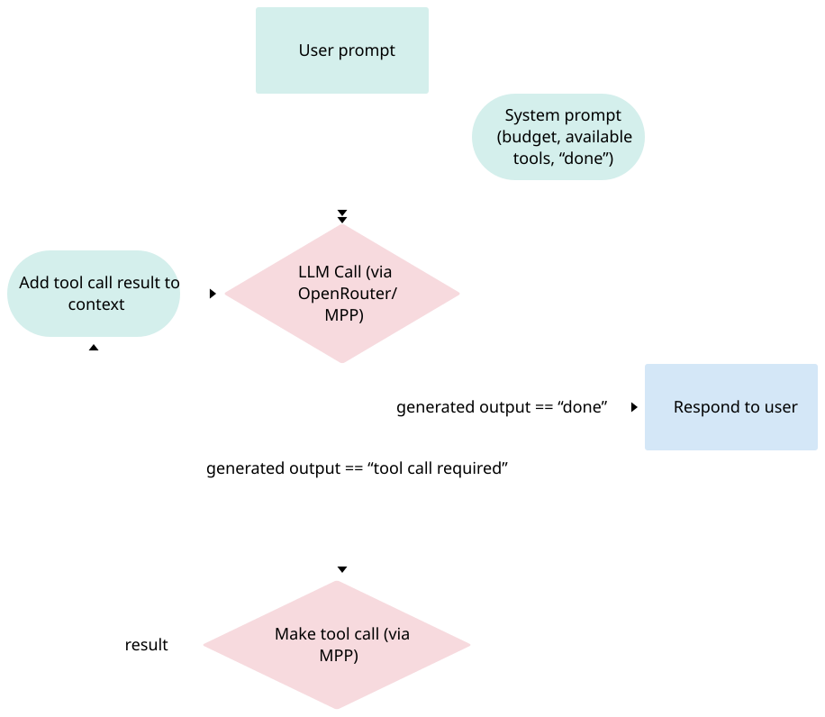

# How the harness works

The LLM has three built-in tools: `http` (call any API), `wait_for` (wait for an async job, below) and `done` (return the answer). With the optional 🧩 sub-agents toggle on, a top-level run also gets `spawn`, described below. It learns which real tools exist by using `http` itself: the system prompt points it at public MPP directories, it reads a service's docs, then calls it. The optional 🧭 tool map adds a short list of verified tools to the system prompt to skip most of that discovery.

Every tool call, including the LLM itself, goes through the same `paidFetch`: send the request, and if the tool answers HTTP 402, check the policy, pay from the wallet and retry.

## Sub-agents (optional)

With the 🧩 toggle on (`"subagents": true` on `POST /api/runs`), the agent gets a third tool, `spawn(task, budget_usd, image_url?, label?)`. It runs this same loop as a sub-agent:

- **Fresh context:** the sub-agent sees only `task`, plus `image_url` as an image it can look at, never the parent's conversation.
- **Its own budget:** carved from what the parent has left, and capped by the parent's inference, tools and per-call limits. Its spend is added back to the parent when it finishes.
- **One level deep:** sub-agents get only `http`, `wait_for` and `done`, and Stop stops them too.
- **One log:** sub-agents have no log of their own. Their calls and thoughts go into the parent's run log, labelled (e.g. `describer-1: think (step 1)`), so totals and on-chain verification still cover every payment.

## Async jobs (`wait_for`)

Some paid tools don't answer in one request: video generation, for example, is submitted to a queue that returns a `status_url` (and a `response_url`), or a server answers `202 Accepted` with a `Location`. Polling with `http` would cost one paid LLM step per poll and the model has no way to sleep, so the harness polls instead:

- **The submit is a normal `http` call.** When a response carries `status_url`/`response_url` (or `poll_url`, `result_url`, `urls.get`), or is a 202, the tool result ends with a `[harness]` note telling the model to call `wait_for`, with the arguments filled in. A 4xx problem+json that says to resubmit to another URL and poll is surfaced the same way.
- **`wait_for(url, until?: {field, in}, then?, every_s?, timeout_s?, reason)`** GETs `url` in code, with no LLM steps in between, until the JSON at `until.field` (a dot path, matched case-insensitively) is one of `until.in`. Then it GETs `then`, if given, and returns that body. Without `until`, it polls until `url` stops answering 202, following `Location` and `Retry-After`. Failed statuses (`FAILED`, `ERROR`, `CANCELLED`…), 400/401/403, three transient errors in a row, a timeout or Stop end the wait early, with a plain message for the model.
- **Polls are ordinary calls.** Each poll and the `then` fetch go through `paidFetch`, so the host blocklist, policy, budgets, allowance check and receipts apply if a status endpoint charges. Each poll has the usual per-call timeout (`CALL_TIMEOUT_MS`); `timeout_s` (default 300, max 900) bounds the whole wait.
- **Bounded:** `every_s` is clamped to 2–60s, one wait makes at most 60 polls, and a run (with its sub-agents) at most `MAX_POLLS_PER_RUN` (150).
- **Logged as one job:** `job.waiting` (at the start and after every poll: polls, elapsed, last status) and `job.finished` (outcome, message). Polls are tagged with the `jobId`, so the run page shows one row per job ("waiting… 45s · 7 polls", then the outcome) with the polls folded into its details. Their payments still count in the receipt, totals and on-chain verification.

Code: `src/jobs.ts`. Offline checks against a mock job server: `pnpm exec tsx scripts/check-wait.ts`.

## Key points

- **The LLM is just another paid tool.** It goes through the same `paidFetch` as every other tool, so inference and tools share one budget and one log.
- **Policy runs before any money moves.** A blocked tool call costs nothing.
- **Costs come from the chain, not the quote.** The charged amount is read from the transaction's transfer logs, so network fees and LLM quote ceilings are reflected.
- **The model never sees the key.** It only gets a receipt line with each tool result.
- **The wallet sets the ceiling.** Payments come from the user's Tempo Wallet through an access key it authorized, so the chain caps total spend (limit and expiry) on top of the harness's per-run budgets.

Code: `src/agent.ts` (loop and `spawn`), `src/jobs.ts` (`wait_for`), `src/paidFetch.ts` (paying for tool calls), `src/policy.ts` (rules), `src/wallet.ts` + `src/keystore.ts` (Tempo Wallet access key or local key, and the mppx client), `src/events.ts` (event log), `src/server.ts` + `site/` (UI).
